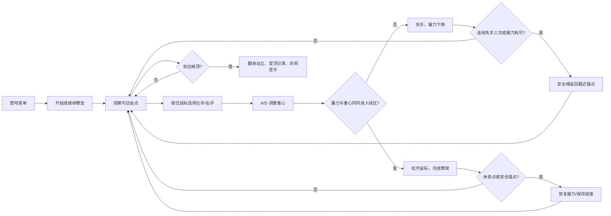

# 《山痕 Mountain Mark》玩法设计文档

**文档版本：** 0.3.1
**文档性质：** 当前可玩原型的玩法基线与后续扩展依据
**项目类型：** 单人、第三人称、3D、短流程攀岩体验
**运行平台：** Windows / Godot 4.7.2

## 1. 产品概述

《山痕》是一段以“专注地向上”为核心的单人攀岩旅程。玩家从松风岩脚出发，沿一面约 72 米高的风脊花岗岩壁逐点上攀，在金色休息岩点恢复握力，在安全锚点保存进度，最终翻上山顶。

游戏的主要乐趣来自三个连续动作：选择下一处岩点、用身体重心稳定伸手、在蓄力窗口内松手完成抓握。角色动画、呼吸、风声、安全绳和逐渐展开的山景共同把“按键判断”转化为“身体正在攀登”的感受。

### 1.1 玩家承诺

玩家每次操作都应回答一个清晰的问题：**我是否能在当前握力和身体姿势下，稳稳抓住下一处岩点？**

玩家应当获得以下体验：

- 看得懂路线，知道哪些岩点可达、哪些岩点值得休息。
- 失手后能理解原因，并能用下一次尝试修正。
- 高度、风景和音乐随进度发生变化，登顶具有明确的情绪回报。
- 失败会增加压力，但不会抹掉已经抵达的安全锚点。

### 1.2 非目标

- 不做战斗、敌人、解谜或联网竞争。
- 不要求玩家管理复杂装备栏、真实绳结或自由布置保护点。
- 不把脚部操作做成独立的高频输入；当前版本由角色自动寻找支撑。
- 不追求长时间刷取资源，单次完整攀登应保持在短途、集中注意力的范围内。

## 2. 体验结构

### 2.1 一局流程



### 2.2 核心循环

1. **观察：** 查看当前可达岩点、距离、方向和休息标记。
2. **计划：** 在稳妥的近点、较快的远点和休息点之间做选择。
3. **准备：** 按住左键或右键，决定使用哪只手。
4. **校准：** 用 A/D 移动重心白针，抵消风和伸手方向带来的偏移。
5. **时机：** 等蓄力白针和重心白针同时位于各自绿区。
6. **兑现：** 松开对应鼠标键，角色伸手、落脚、蹬腿并移动到目标岩点。
7. **恢复：** 在休息点停留，或在锚点使用安全绳回退后重新规划。

## 3. 世界与关卡基线

### 3.1 路线信息

| 项目 | 当前基线 |
| --- | --- |
| 场景 | 松风岩脚 → 风脊岩壁 → 群山之上 |
| 垂直路线 | 约 72 米 |
| 主线抓点 | 57 个，按高度顺序布置 |
| 备选抓点 | 14 个，用于侧向调整和路线选择 |
| 抓点总量 | 71 个，以 `world.holds` 为准 |
| 安全锚点 | 起点、约 18 米、36 米、54 米、72 米，共 5 个 |
| 休息点 | 每约 7 个主线抓点安排一个金色岩点，部分与锚点重合 |
| 章节 | 起攀、风蚀石阶、云间横渡、天光之脊、群山之上 |
| 目标 | 抵达最高抓点并触发登顶演出 |

抓点沿墙面大致向上排列，垂直间隔约 1.1–1.6 米，横向位移控制在角色可伸手范围内。主线用于保证可通关，备选点用于让玩家在握力不足或重心不佳时改变走法。完整主线路径需要 56 次有效落手。

### 3.2 章节节奏

| 区段 | 高度 | 玩法重点 | 环境与情绪 |
| --- | ---: | --- | --- |
| 起攀 · 松风岩脚 | 0–18m | 学会选点、交替使用双手、理解双绿区 | 营地、帐篷、低风、视野受限 |
| 第一段 · 风蚀石阶 | 18–36m | 出现更远的落点，开始管理握力与休息点 | 岩缝风声增强，路线开始侧向移动 |
| 第二段 · 云间横渡 | 36–54m | 高处判定窗口变窄，阵风影响重心 | 云层沉到身后，远景扩大，节奏变慢 |
| 第三段 · 天光之脊 | 54–72m | 规划锚点前最后一段，控制失误次数 | 光线变暖，峰顶轮廓和旗帜可见 |
| 终点 · 群山之上 | 72m+ | 不再输入，观看翻身、站立和庆祝动作 | 镜头拉远，登顶音乐覆盖风声 |

## 4. 操作与交互规则

| 输入 | 行为 | 设计目的 |
| --- | --- | --- |
| 鼠标左键按住/松开 | 准备并使用左手抓握 | 让“按住—稳住—松手”成为身体动作 |
| 鼠标右键按住/松开 | 准备并使用右手抓握 | 鼓励左右手交替，减少连续同手消耗 |
| A / D | 向左/右移动重心白针 | 将姿势调整纳入每次抓握，而非只看时机条 |
| W / ↑ | 标记建议上行岩点 | 辅助观察路线，不替玩家完成攀爬 |
| 中键拖拽 | 左右/上下旋转读线视角 | 在正式抓握前观察落点与身体的横向关系 |
| Z / X | 左右旋转读线视角 | 不使用鼠标拖拽时的键盘替代方案；Q / E 保留给支撑脚选择 |
| 空格 | 使用一次镁粉 | 以有限资源换取握力缓冲 |
| R | 沿安全绳返回最近锚点 | 主动止损并重新规划 |
| Esc | 暂停/继续 | 暂停时取消未完成抓握 |
| M | 开关全部声音 | 支持安静游玩 |
| F11 | 窗口/全屏切换 | 适配不同游玩环境 |

### 4.1 抓握状态机

```text
待机
  └─ 按住可达岩点 → 准备中
       ├─ 松开且双条件满足 → 攀爬动画 → 到达岩点
       ├─ 松开但条件不满足 → 失手
       ├─ 超过 4.5 秒 → 失手
       ├─ 握力归零 → 跌落保护
       └─ 切出窗口/暂停 → 取消准备，回到待机
```

一次抓握至少准备 0.2 秒，最多持续 4.5 秒。普通单击不会直接移动角色；玩家必须完成准备、重心校准和松手时机三步。

### 4.2 读线视角

玩家按 W/↑ 标记建议岩点后，可以在未抓握、未移动的状态下按住鼠标中键拖拽镜头，或按 Z/X 左右旋转镜头，观察当前身体、目标岩点和相邻备选点的横向关系。标记点旁显示建议使用的手以及“重心偏左 / 重心居中 / 重心偏右”，身体与目标之间还会显示一条读线辅助线。

读线视角只改变观察角度和提示，不改变抓点可达范围、实际重心目标或握力消耗；一旦开始抓握，中键和 Z/X 都不再改变镜头。这样玩家可以用视角帮助理解判定，但不会因为换一个角度而获得不同规则。

## 5. 抓握判定与数值

### 5.1 蓄力白针

蓄力指针以约 2.2 秒为一个往返周期，目标点随距离、海拔和抓点编号轻微变化。当前实现的目标值约为 0.57–0.77。

判定窗口随进度收窄：

- 起始窗口约 ±0.16。
- 峰顶附近约 ±0.10。
- 远距离抓点额外缩小约 0.015。

### 5.2 重心白针

重心受 A/D 输入和阵风共同影响。目标值由目标岩点横向位置、所用手和当前高度决定，并限制在 -0.80 到 0.80。

- 起始窗口约 ±0.30。
- 峰顶附近约 ±0.20。
- 远距离抓点额外缩小约 0.025。
- 高处风力扰动随海拔增加，要求玩家在绿区内持续修正。

### 5.3 成功质量与握力消耗

抓握质量由蓄力误差和重心误差共同决定，越靠近目标中心，质量越高。一次移动的基础消耗为：

```text
消耗 = 4.0
     + 伸手距离 × 2.2
     + 跨过身体出手额外 2.5
     + 连续使用同一只手额外 1.5
     + (1 - 抓握质量) × 3.0
```

这套规则让“近点更稳、远点更快、交替用手更省力”同时成立。玩家不需要计算公式，HUD 只显示“稳妥 / 需发力 / 远点·费力”等可读提示。

### 5.4 握力与恢复

| 行为 | 握力变化 |
| --- | ---: |
| 初始/返回锚点 | 恢复至 100 |
| 非移动攀爬待机 | 每秒约 -0.38 |
| 按住岩点准备 | 每秒约 -1.60 |
| 失手 | 额外 -11 |
| 镁粉 | +10，单段最多 3 次，冷却 7 秒 |
| 金色休息点 | 停留时每秒约 +23，最高 100 |
| 连续三次失手或握力耗尽 | 触发安全绳 |

休息点是“停留恢复”，锚点是“保存与补给”。两者功能分开，玩家能在路线中途缓慢回满握力，也能在关键节点获得明确的失败保护。

## 6. 失败、回退与存档

### 6.1 失败类型

- **重心没有稳住：** A/D 调整不足，松手时重心不在绿区。
- **松手时机不对：** 蓄力白针未进入绿区。
- **悬挂太久：** 超过 4.5 秒未完成准备。
- **握力耗尽：** 准备过程中或待机时握力归零。
- **主动返回：** 玩家按 R，沿安全绳回到最近锚点。

前三类失手先扣握力并累计失手次数。连续三次失手，或握力耗尽，进入跌落提示界面；角色暂停，玩家按 Enter 或按钮确认后再返回。

### 6.2 回退规则

- 已抵达锚点：返回最近锚点。
- 尚未抵达第一个锚点：返回山脚营地。
- 返回后握力恢复至 100，镁粉补满 3 次。
- 已保存的攀登进度、总移动次数、累计失败次数保留。
- 失败提示明确展示触发原因和返回位置，避免“随机惩罚感”。

### 6.3 存档数据

存档位于游戏目录 `.runtime/save.json`，当前记录：

- 最近安全锚点。
- 当前旅程用时。
- 累计跌落次数。
- 已完成移动次数。
- 是否存在未完成旅程。
- 登顶次数。
- 最佳用时。
- 是否完成“零跌落”登顶记录。

存档在抵达锚点、跌落、返回菜单、退出游戏和登顶时写入。测试参数启动时不写入玩家存档。

## 7. 角色与反馈设计

### 7.1 角色动作

角色采用程序化身体，不依赖外部角色资产。一次成功攀爬包含：

1. 领先手伸向目标岩点。
2. 另一只手保持支撑或随后跟进。
3. 领先脚先落位，支撑脚随后移动。
4. 身体沿短步序列抬升，避免整体“漂移”。
5. 背包、四肢、手套、靴子和绳索随身体位置更新。

登顶时角色先拉过岩唇，再把双脚放到平台，最后站直举臂。该演出是玩法完成后的主要情绪奖励。

### 7.2 可读反馈

HUD 必须让玩家同时看到：

- 当前章节和垂直高度。
- 路线竖向进度与锚点位置。
- 握力数值、镁粉剩余次数和当前状态。
- 可达岩点、休息点、锚点和 W 标记的建议点。
- 蓄力绿区、重心绿区、两个白针和剩余准备时间。
- 失手原因、累计失手次数和安全绳触发条件。

信息优先级遵循“当前动作 > 当前资源 > 路线进度 > 叙事装饰”。

## 8. 视听设计

### 8.1 视觉节奏

- 岩壁使用暖色低多边形花岗岩，抓点使用浅色，休息点使用金色。
- 可达岩点通过环形标记显示，选中点放大并提高发光强度。
- 远景使用冷色群山和云层，随高度增加逐渐打开视野。
- 接近峰顶时色温变暖，旗帜、平台和最终视野成为明确目标。
- 摄像机跟随身体平滑移动，登顶后逐渐拉远，呈现高度变化。

### 8.2 声音触发

| 声音 | 触发 | 作用 |
| --- | --- | --- |
| 风声与远处和声 | 持续播放，随海拔变化 | 建立空间和高度感 |
| 岩石抓握 | 成功抓握 | 强化输入兑现 |
| 镁粉 | 使用空格 | 让资源消耗有触觉反馈 |
| 安全绳 | 失手/跌落 | 明确保护介入 |
| 呼吸 | 攀爬后间歇 | 连接握力和身体状态 |
| 休息点提示 | 到达休息/锚点 | 提供阶段性奖励 |
| 登顶音乐 | 首次登顶 | 完成情绪释放 |

所有声音由项目内离线生成，静音时停止动作音效和音乐并保留可恢复的环境状态。

## 9. 难度与公平性

难度只通过玩家可理解的身体约束增加，不依赖隐藏随机伤害：

- 远点消耗更多握力，且更容易跨手。
- 高处绿区变窄，阵风更明显。
- 连续使用同一只手更费力，鼓励节奏化交替。
- 休息点和锚点按固定节奏出现，玩家可提前规划。
- 失手反馈给出具体原因，三次保护机制避免长时间重复跌落。

辅助设计：W/↑ 提供观察建议但不自动攀爬；HUD 给出距离和费力程度；R 允许玩家主动止损；暂停和切出窗口会取消未完成抓握，避免误触。

## 10. 成功标准与验收

一条可交付的玩法版本应满足：

1. 新玩家能在营地提示中理解“按住鼠标、A/D 稳重心、双绿区松手”。
2. 从起点到峰顶存在至少一条连续可达路线。
3. 全路线自动测试可完成约 56 次主线移动，且不会因非法抓点或状态卡死而中断。
4. 失败后能稳定进入提示、确认、返回锚点、继续攀登的完整链路。
5. 锚点保存、继续旅程、登顶统计和最佳用时可在重启后恢复。
6. 暂停、静音、全屏、正常退出和窗口切出不会破坏存档或遗留抓握状态。
7. 登顶演出至少包含翻身、站立、镜头拉远、音乐和记录展示五个反馈层。

建议持续关注的体验指标：

- 首次抓握成功率。
- 第一次到达 18 米锚点所需时间。
- 每个区段平均失手次数。
- 使用镁粉的高度分布。
- 主动返回比例。
- 无跌落登顶比例和最佳用时。

## 11. 后续扩展边界

在不破坏当前核心循环的前提下，可按以下顺序扩展：

1. 增加第二条路线，使用不同的休息点分布和横向转移节奏。
2. 增加“自由选脚”作为高阶模式，保留当前自动脚部作为默认体验。
3. 将镁粉升级为少量装备选择，例如恢复型、稳定型和远距型。
4. 增加练习模式，允许玩家单独练习蓄力或重心，不计入正式记录。
5. 增加照片/路线回放，但不引入联网排行榜作为核心目标。

任何扩展都应继续遵守三条原则：下一步看得懂、失误说得清、进度保得住。
